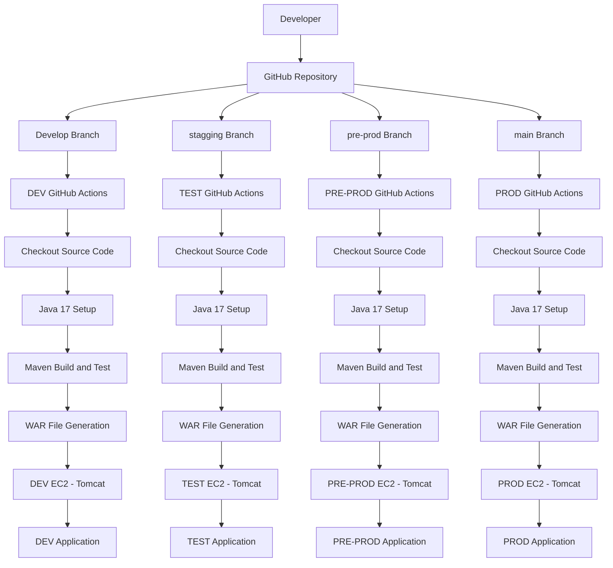
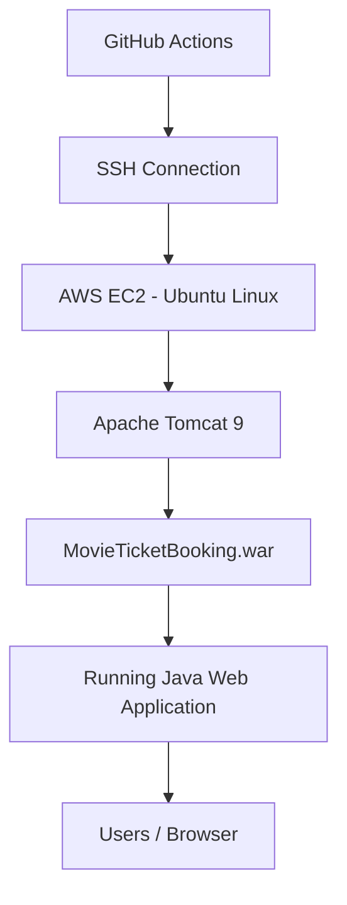
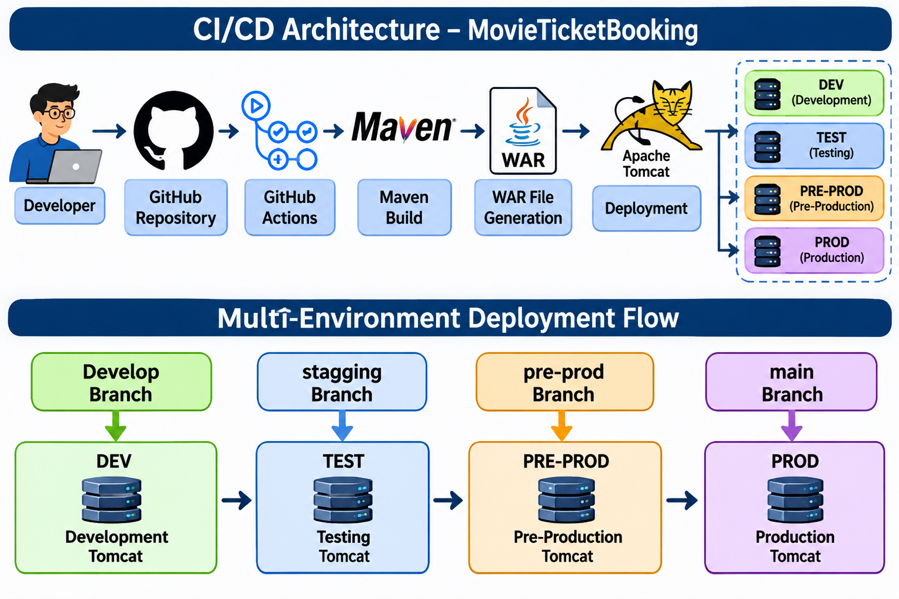
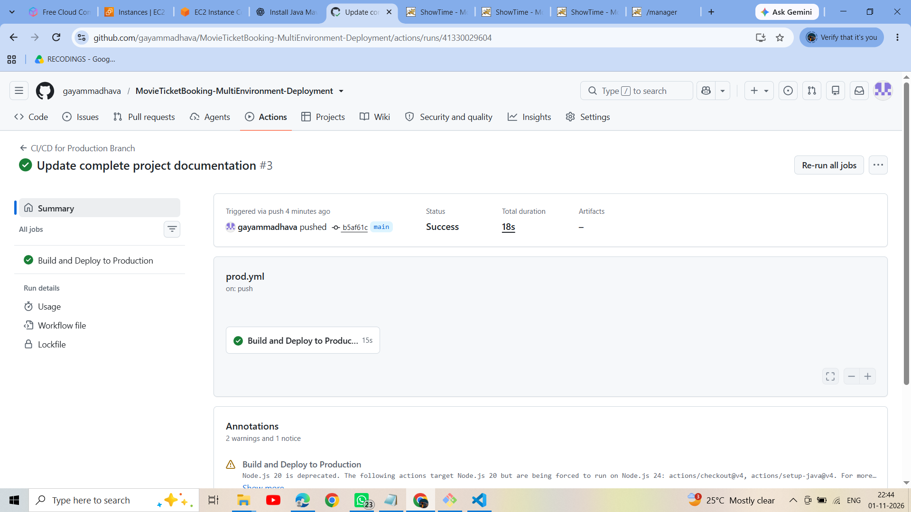
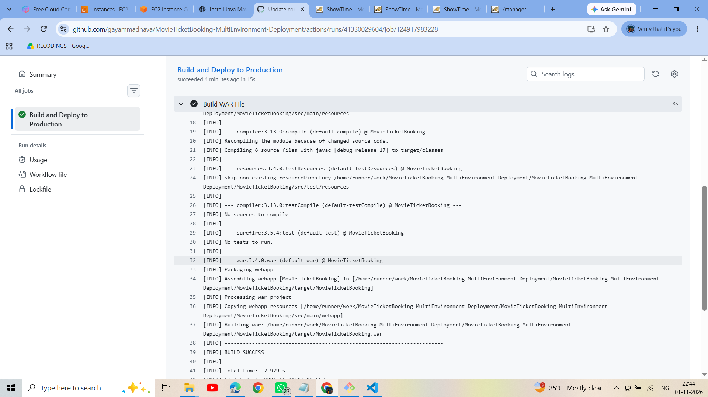
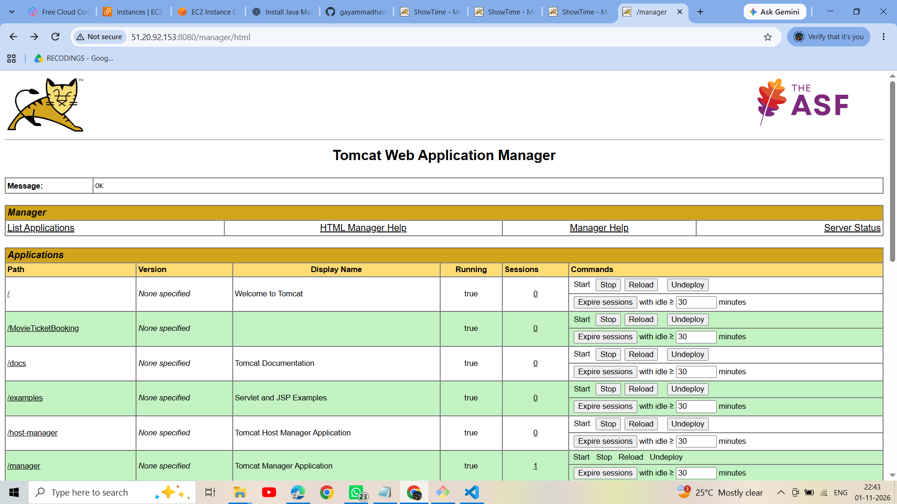
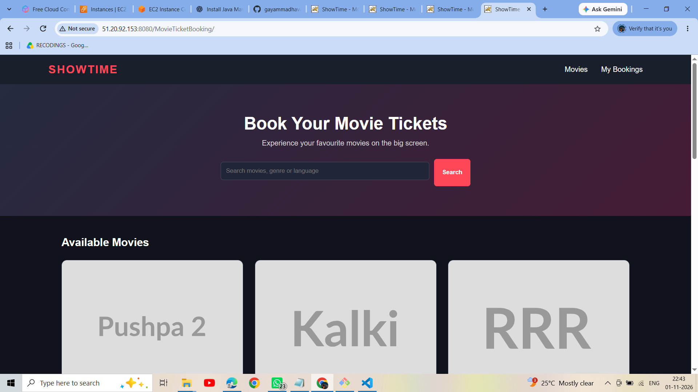

# MovieTicketBooking – Multi-Environment CI/CD Deployment

## 1. Project Overview

MovieTicketBooking is a Java-based web application deployed using an automated Continuous Integration and Continuous Deployment (CI/CD) pipeline.

This project demonstrates how to automate application builds and deployments across multiple environments using GitHub Actions, Maven, Apache Tomcat, Git, and AWS EC2.

The application is deployed independently to four environments:

- DEV
- TEST
- PRE-PROD
- PROD

Whenever developers push code to a configured Git branch, GitHub Actions automatically triggers the corresponding pipeline, builds the application, generates a WAR file, and deploys it to the appropriate Tomcat server.

## 2. Project Objectives

- Automate Java application builds using Maven.
- Implement CI/CD using GitHub Actions.
- Configure multiple deployment environments.
- Implement branch-based deployment strategies.
- Deploy WAR files to Apache Tomcat.
- Manage environment-specific credentials securely.
- Reduce manual deployment activities.
- Maintain separate development, testing, pre-production, and production environments.

## 3. Technologies Used

| Technology | Purpose |
|---|---|
| Java 17 | Application development |
| Maven | Build automation and dependency management |
| Apache Tomcat 9 | Application server |
| Git | Version control |
| GitHub | Source code management |
| GitHub Actions | CI/CD automation |
| AWS EC2 | Server infrastructure |
| Ubuntu Linux | Server operating system |
| Shell Scripting | Deployment automation |
| GitHub Environments | Environment-specific secrets and approvals |

## 4. Project Architecture

### 4.1 High-Level CI/CD Architecture

The project follows a branch-based deployment architecture. Each Git branch is connected to a separate GitHub Actions workflow and deployment environment.



### 4.2 Deployment Architecture Explanation

**Developer Layer**
- Developers write and modify Java application code.
- Changes are committed and pushed to GitHub.

**Source Code Management Layer**
- GitHub maintains the application source code.
- Separate branches represent different deployment environments.

**CI/CD Layer**
- GitHub Actions automatically triggers workflows.
- Each workflow checks out the source code.
- Java 17 is configured.
- Maven compiles, tests, and packages the application.

**Build Layer**
- Maven generates the WAR file.
- The pipeline verifies the generated artifact.
- Deployment proceeds only after a successful build.

**Deployment Layer**
- GitHub Actions connects to the appropriate AWS EC2 instance using SSH.
- The WAR file is uploaded through the Tomcat Manager Text API.
- Tomcat deploys or updates the application.

**Application Layer**
- Each environment runs an independent Tomcat instance.
- Users access the application through the respective environment URL.

### 4.3 Individual Environment Architecture



This deployment architecture is repeated independently for DEV, TEST, PRE-PROD, and PROD.

## 5. Multi-Environment Strategy

This project uses four separate Git branches and four GitHub deployment environments.

| Git Branch | GitHub Environment | Purpose |
|---|---|---|
| Develop | DEV | Development and initial validation |
| stagging | TEST | Application testing |
| pre-prod | PRE-PROD | Final validation before production |
| main | PROD | Live production deployment |

### Deployment Flow

```text
Developer
   |
   v
Develop Branch
   |
   v
DEV Environment
   |
   v
stagging Branch
   |
   v
TEST Environment
   |
   v
pre-prod Branch
   |
   v
PRE-PROD Environment
   |
   v
main Branch
   |
   v
PROD Environment
```

Each branch triggers its corresponding GitHub Actions workflow.

## 6. GitHub Repository Structure

```text
MovieTicketBooking-MultiEnvironment-Deployment/
│
├── .github/
│   └── workflows/
│       ├── dev.yml
│       ├── staging.yml
│       ├── pre-prod.yml
│       └── prod.yml
│
├── MovieTicketBooking/
│   ├── pom.xml
│   └── src/
│       ├── main/
│       │   ├── java/
│       │   └── webapp/
│       └── test/
│
├── README.md
│
└── images/
    ├── architecture.png
    ├── github-actions.png
    ├── maven-build.png
    ├── tomcat-deployment.png
    └── application.png
```

## 7. CI/CD Pipeline Explanation

### Stage 1: Source Code Management

Developers maintain application source code in GitHub.

When code is pushed to a configured branch, GitHub Actions receives a push event.

### Stage 2: Workflow Trigger

Each environment has a separate workflow.

- `Develop` triggers DEV.
- `stagging` triggers TEST.
- `pre-prod` triggers PRE-PROD.
- `main` triggers PROD.

### Stage 3: Checkout Source Code

GitHub Actions uses the checkout action to download the repository.

```yaml
- name: Checkout Source Code
  uses: actions/checkout@v4
```

### Stage 4: Java Setup

Java 17 is configured using the setup-java action.

```yaml
- name: Set up Java 17
  uses: actions/setup-java@v4
  with:
    distribution: temurin
    java-version: '17'
    cache: maven
    cache-dependency-path: MovieTicketBooking/pom.xml
```

### Stage 5: Maven Build

Maven compiles the application, runs configured tests, and verifies the project.

```bash
cd MovieTicketBooking
mvn -B clean verify
```

### Stage 6: WAR File Verification

After a successful build, verify that the WAR file exists.

```bash
ls -lh target/

test -f target/MovieTicketBooking.war
```

Generated artifact:

```text
MovieTicketBooking/target/MovieTicketBooking.war
```

### Stage 7: Deployment

The WAR file is uploaded to the corresponding Tomcat server using the Tomcat Manager Text API.

```bash
curl --fail-with-body \
  --silent --show-error \
  --user "$TOMCAT_USER:$TOMCAT_PASSWORD" \
  --upload-file target/MovieTicketBooking.war \
  "$TOMCAT_HOST/manager/text/deploy?path=/MovieTicketBooking&update=true"
```

### Stage 8: Deployment Verification

After deployment, verify the application using its environment-specific URL.

```text
http://YOUR_TOMCAT_HOST:8080/MovieTicketBooking/
```

## 8. Maven Commands

| Command | Purpose |
|---|---|
| `mvn clean` | Removes previous build files |
| `mvn compile` | Compiles Java source code |
| `mvn test` | Executes unit tests |
| `mvn package` | Generates the WAR package |
| `mvn verify` | Runs verification lifecycle checks |
| `mvn -B clean verify` | Performs a clean build and verification in batch mode |

## 9. GitHub Actions Workflows

Four separate workflow files are maintained.

| Workflow File | Trigger Branch | Environment |
|---|---|---|
| `dev.yml` | Develop | DEV |
| `staging.yml` | stagging | TEST |
| `pre-prod.yml` | pre-prod | PRE-PROD |
| `prod.yml` | main | PROD |

Each workflow performs:

1. Checkout source code.
2. Set up Java 17.
3. Build using Maven.
4. Verify the WAR file.
5. Deploy to the corresponding Tomcat server.
6. Report deployment status.

## 10. GitHub Environment Configuration

Create the following environments in:

GitHub Repository → Settings → Environments

- DEV
- TEST
- PRE-PROD
- PROD

Configure these secrets separately inside each environment:

| Secret Name | Description |
|---|---|
| `TOMCAT_HOST` | Environment-specific Tomcat server URL |
| `TOMCAT_USER` | Tomcat deployment username |
| `TOMCAT_PASSWORD` | Tomcat deployment password |

Never hardcode passwords or sensitive credentials in workflow files.

Production deployment can be protected with required reviewers and environment approval rules.

## 11. Tomcat Configuration

Apache Tomcat 9 is used to host the Java web application.

The Tomcat deployment user requires the `manager-script` role to access the Manager Text API.

Example Tomcat configuration:

```xml
<role rolename="manager-script"/>

<user username="deploy"
      password="CHANGE_THIS_PASSWORD"
      roles="manager-script"/>
```

The Tomcat Manager interface should be restricted to trusted networks. Do not expose deployment credentials or the Manager API publicly.

## 12. Git Commands

### Clone Repository

```bash
git clone https://github.com/gayammadhava/MovieTicketBooking-MultiEnvironment-Deployment.git
```

### Check Branches

```bash
git branch
git branch -r
git branch -a
```

### Switch Branches

```bash
git checkout Develop
git checkout stagging
git checkout pre-prod
git checkout main
```

### Add and Commit Changes

```bash
git add .
git commit -m "Update application"
```

### Push Changes

```bash
git push origin Develop
git push origin stagging
git push origin pre-prod
git push origin main
```

### Pull Latest Changes

```bash
git pull origin main
```

### Rename a Branch

```bash
git branch -m old-name new-name
```

### View Commit History

```bash
git log --oneline
```

## 13. Deployment URLs

After successful deployment, access the application using the respective Tomcat server.

| Environment | Application URL |
|---|---|
| DEV | `http://DEV_SERVER:8080/MovieTicketBooking/` |
| TEST | `http://TEST_SERVER:8080/MovieTicketBooking/` |
| PRE-PROD | `http://PREPROD_SERVER:8080/MovieTicketBooking/` |
| PROD | `http://PROD_SERVER:8080/MovieTicketBooking/` |

Replace the placeholders with your actual server addresses.

## 14. Advantages of This Project

- Automated CI/CD deployment.
- Separate environments for different development stages.
- Branch-based deployment automation.
- Consistent Maven build process.
- Reduced manual deployment effort.
- Secure environment-specific credentials.
- Production deployment approval.
- Easier application maintenance.
- Improved release management.
- Faster delivery of application updates.

## 15. Future Enhancements

- Integrate SonarQube for code quality analysis.
- Integrate Nexus or JFrog for artifact management.
- Add automated integration testing.
- Add deployment health checks.
- Implement rollback strategies.
- Configure monitoring and logging.
- Introduce Docker-based deployment.
- Implement Kubernetes-based orchestration.

## 16. Author

**Gayam Madhava Reddy**

GitHub: https://github.com/gayammadhava

Project: MovieTicketBooking – Multi-Environment CI/CD Deployment

---

**Project Summary:**

This project demonstrates an end-to-end CI/CD implementation for a Java web application using GitHub Actions, Maven, Apache Tomcat, Git, and AWS EC2, with automated deployments across DEV, TEST, PRE-PROD, and PROD environments.

---

# 17. Project Screenshots

## 1. CI/CD Architecture & Multi-Environment Deployment



## 2. GitHub Actions Workflow



## 3. Maven Build Success



## 4. Tomcat Deployment



## 5. Movie Ticket Booking Application


